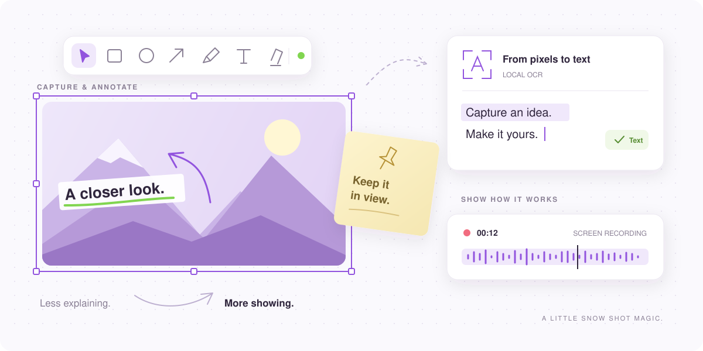

<div align="center">
  <a href="https://snowshot.top">
    
  </a>

  <h1>Snow Shot</h1>

  <p><strong>Capture. Annotate. Keep creating.</strong></p>
  <p>A free, open-source screenshot and screen recording tool for Windows and macOS.</p>

  <p>
    <a href="https://github.com/mg-chao/snow-shot/releases"></a>
    <a href="https://github.com/mg-chao/snow-shot/releases"></a>
    <a href="https://github.com/mg-chao/snow-shot/stargazers"></a>
    <a href="https://github.com/mg-chao/snow-shot/commits"></a>
    <a href="snow_shot/COPYRIGHT"></a>
  </p>

  <p>
    <a href="#download"></a>
    <a href="#download"></a>
    <a href="docs/development.md"></a>
    <a href="docs/development.md"></a>
    <a href="docs/development.md"></a>
  </p>

  <p>
    <a href="https://snowshot.top"><strong>Website</strong></a> ·
    <a href="https://github.com/mg-chao/snow-shot/releases"><strong>Download</strong></a> ·
    <a href="https://github.com/mg-chao/snow-shot/issues">Report a bug</a> ·
    English · <a href="README.zh-CN.md">简体中文</a>
  </p>
</div>

<br>

<p align="center">
  <picture>
    <source media="(prefers-color-scheme: dark)" srcset="docs/images/readme/showcase-dark.svg">
    
  </picture>
</p>

<p align="center"><sub>A little capture. A clearer idea. An illustrated look at the Snow Shot toolkit.</sub></p>

## ✨ Features

- 📸 **Capture what matters.** Select a region, capture the focused window or current monitor, set a delay, or take a scrolling screenshot.
- ✏️ **Make your point.** Add arrows, shapes, text, numbered steps, highlights, blur, and more. Edit existing images with the same drawing tools.
- 📌 **Keep references close.** Pin images and clipboard content above other windows, then organize and restore your pins.
- 🔎 **Turn pixels into text.** Extract text with local OCR and read QR codes. Optional online services add translation, table recognition, and AI conversion.
- 🎬 **Show how it works.** Record your screen, include system or microphone audio, and export video or GIF, APNG, and WebP animations.
- 🧩 **Finish the picture.** Stitch images, split them into pieces, or sketch on a full-screen canvas.
- 🎨 **Make it yours.** Customize shortcuts, toolbars, themes, and export preferences. Use the interface in English, Simplified Chinese, or Traditional Chinese.
- 🔌 **Connect your workflow.** Enable MCP integration to let a compatible AI client use supported Snow Shot tools.

Core capture, annotation, recording, standard OCR, and QR recognition run on your device.
Translation, advanced recognition, AI conversion, and cloud uploads use the services you choose.
MCP is optional and off by default. See the [privacy policy](docs/snow-shot-privacy-policy.en.md).

<a id="download"></a>

## 📦 Download

[](docs/snow-shot-releases.md#winget)
[](docs/snow-shot-releases.md#scoop)
[](docs-macos-build.md#homebrew-installation)

Get Snow Shot from [GitHub Releases](https://github.com/mg-chao/snow-shot/releases).
Choose a package for your operating system and processor.

| Platform | Packages |
| --- | --- |
| **Windows · x64 / ARM64** | Installer or portable ZIP; the full edition's offline installer includes the default OCR resources. |
| **macOS 15+ · Apple Silicon / Intel** | DMG or Homebrew; availability depends on the architectures included in the release. |

<details>
<summary><strong>Windows · WinGet</strong></summary>

```powershell
winget install --exact --id mg-chao.snow-shot --source winget
```

The package includes the default OCR resources and can include published beta versions.
See [WinGet installation and updates](docs/snow-shot-releases.md#winget).

</details>

<details>
<summary><strong>Windows · Scoop</strong></summary>

Install the Windows x64 portable edition from the official Extras bucket:

```powershell
scoop bucket add extras
scoop install extras/snowshot
```

Quit Snow Shot before upgrading with `scoop update snowshot`; use Scoop to manage
updates. Settings and history persist across upgrades and ordinary uninstall.
See [Scoop installation and updates](docs/snow-shot-releases.md#scoop).

</details>

<details>
<summary><strong>macOS · Homebrew</strong></summary>

```sh
brew update
brew install --cask mg-chao/tap/snow-shot
```

To update, quit Snow Shot and run `brew upgrade --cask snow-shot`.
Installation uses a local signing identity and may request Keychain access and macOS
privacy permissions. See [installation and migration](docs-macos-build.md#homebrew-installation).

</details>

<details>
<summary><strong>Snow Shot or Snow Shot Mini?</strong></summary>

**Snow Shot** includes the full toolkit. **Snow Shot Mini** keeps capture, annotation,
pinning, recording, and manual text recognition, with OCR models downloaded on demand.
Mini omits QR, table, Markdown, HTML, LaTeX, translation, Extended Features, and API Configuration.

Mini is available for Windows and Apple Silicon Macs. Its text-recognition toolbar
button is hidden by default, and automatic recognition of pinned content is off.
See [edition details](docs/snow-shot-releases.md#snow-shot-mini-paired-releases).

</details>

## 🚀 Get started

1. **Set your shortcut.** Open Snow Shot and choose a capture action in **Global shortcuts**.
2. **Select and refine.** Capture a region, add annotations, or run text recognition.
3. **Keep it moving.** Copy the result, save it, or pin it beside your work. Use screen recording when a still image is not enough.

On macOS, follow the permission prompts for the features you use.
For installation help and platform notes, visit the [website](https://snowshot.top)
or the [macOS guide](docs-macos-build.md).

## 🛠 Development

Snow Shot is built with **C++ / Qt and Rust**.

```sh
git clone --recurse-submodules https://github.com/mg-chao/snow-shot.git
cd snow-shot
```

The [development guide](docs/development.md) covers platform setup, build commands,
focused validation, and the OCR submodule. See also the [macOS](docs-macos-build.md)
and [Windows ARM64](docs-windows-arm64-build.md) guides.

## 🤝 Contributing

Found a bug? [Open an issue](https://github.com/mg-chao/snow-shot/issues) with your
OS, Snow Shot version, and steps to reproduce it.

Only bug-fix PRs are reviewed. For new features or enhancements, start a community
discussion before submitting a PR. Read [CONTRIBUTING.md](CONTRIBUTING.md) and
[AGENTS.md](AGENTS.md) before making changes.

[](https://linux.do)

## 📄 License

Snow Shot is licensed under [GPL-3.0-or-later](snow_shot/COPYRIGHT).
Components and bundled dependencies retain their respective licenses; see the
[repository license scope](LICENSE.md) and
[third-party notices](snow_shot/THIRD_PARTY_NOTICES.md).
