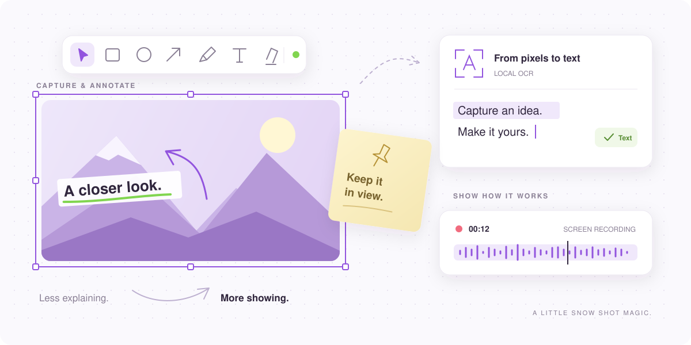

<div align="center">
  <a href="https://snowshot.top">
    
  </a>

  <h1>Snow Shot</h1>

  <p><strong>截图、标注、录屏，一气呵成。</strong></p>
  <p>适用于 Windows 和 macOS 的免费开源截图与录屏工具。</p>

  <p>
    <a href="https://github.com/mg-chao/snow-shot/releases"></a>
    <a href="https://github.com/mg-chao/snow-shot/releases"></a>
    <a href="https://github.com/mg-chao/snow-shot/stargazers"></a>
    <a href="https://github.com/mg-chao/snow-shot/commits"></a>
    <a href="snow_shot/COPYRIGHT"></a>
  </p>

  <p>
    <a href="#download"></a>
    <a href="#download"></a>
    <a href="docs/development.md"></a>
    <a href="docs/development.md"></a>
    <a href="docs/development.md"></a>
  </p>

  <p>
    <a href="https://snowshot.top"><strong>官方网站</strong></a> ·
    <a href="https://github.com/mg-chao/snow-shot/releases"><strong>下载使用</strong></a> ·
    <a href="https://github.com/mg-chao/snow-shot/issues">反馈问题</a> ·
    <a href="README.md">English</a> · 简体中文
  </p>
</div>

<br>

<p align="center">
  <picture>
    <source media="(prefers-color-scheme: dark)" srcset="docs/images/readme/showcase-dark.svg">
    
  </picture>
</p>

<p align="center"><sub>截取一刻，表达更多。上图为 Snow Shot 功能示意插画。</sub></p>

## ✨ 特性

- 📸 **截下想要的画面。** 区域截图、焦点窗口、当前显示器、延时截图与滚动长截图，适配不同场景。
- ✏️ **把重点讲清楚。** 箭头、形状、文字、序号、高亮、模糊等标注工具，也能用来编辑已有图片。
- 📌 **让参考资料留在眼前。** 将图片和剪贴板内容固定在其他窗口上方，随时整理、恢复贴图。
- 🔎 **把图片变成文字。** 本地 OCR 提取文本、识别二维码；还可选用在线服务进行翻译、表格识别和 AI 转换。
- 🎬 **把操作过程录下来。** 录制屏幕，按需加入系统音频或麦克风，导出视频或 GIF、APNG、WebP 动图。
- 🧩 **继续处理你的图片。** 拼接多张图片、分割图像，或用全屏画布随手讲解。
- 🎨 **调整成顺手的样子。** 自定义快捷键、工具栏、主题与导出选项，支持简体中文、繁體中文和 English 界面。
- 🔌 **接入你的工作流。** 按需开启 MCP，让兼容的 AI 客户端调用 Snow Shot 支持的工具。

截图、标注、录屏、普通文字识别和二维码识别在本机完成。
翻译、高级识别、AI 转换及云上传会使用你选择的服务；MCP 默认关闭，可按需开启。
详见[隐私政策](docs/snow-shot-privacy-policy.zh-CN.md)。

<a id="download"></a>

## 📦 下载安装

[](docs/snow-shot-releases.md#winget)
[](docs/snow-shot-releases.md#scoop)
[](docs-macos-build.md#homebrew-installation)

前往 [GitHub Releases](https://github.com/mg-chao/snow-shot/releases)，选择与你的系统和处理器匹配的安装包。

| 平台 | 安装方式 |
| --- | --- |
| **Windows · x64 / ARM64** | 安装程序或便携 ZIP；完整版离线安装包包含默认 OCR 资源。 |
| **macOS 15+ · Apple Silicon / Intel** | DMG 或 Homebrew；可用架构以对应版本的发布文件为准。 |

<details>
<summary><strong>Windows · WinGet</strong></summary>

```powershell
winget install --exact --id mg-chao.snow-shot --source winget
```

包含默认 OCR 资源，软件源也可能收录已发布的 Beta 版本。
详见 [WinGet 安装与更新说明](docs/snow-shot-releases.md#winget)。

</details>

<details>
<summary><strong>Windows · Scoop</strong></summary>

通过官方 Extras 软件源安装 Windows x64 便携版：

```powershell
scoop bucket add extras
scoop install extras/snowshot
```

升级前退出 Snow Shot，并使用 `scoop update snowshot` 管理更新。
升级及普通卸载会保留设置和历史记录，详见 [Scoop 安装与更新说明](docs/snow-shot-releases.md#scoop)。

</details>

<details>
<summary><strong>macOS · Homebrew</strong></summary>

```sh
brew update
brew install --cask mg-chao/tap/snow-shot
```

更新时先退出 Snow Shot，再运行 `brew upgrade --cask snow-shot`。
安装过程使用本地签名身份，可能请求钥匙串访问及 macOS 隐私权限。
详见[安装与迁移说明](docs-macos-build.md#homebrew-installation)。

</details>

<details>
<summary><strong>Snow Shot 和 Snow Shot Mini 怎么选？</strong></summary>

**Snow Shot** 提供完整功能。**Snow Shot Mini** 保留截图、标注、贴图、录屏与手动文字识别，OCR 模型按需下载。
Mini 不包含二维码、表格、Markdown、HTML、LaTeX、翻译、扩展功能及 API 配置。

Mini 支持 Windows 和 Apple Silicon Mac。其文字识别工具栏按钮默认隐藏，贴图自动识别默认关闭。
详见[版本差异说明](docs/snow-shot-releases.md#snow-shot-mini-paired-releases)。

</details>

## 🚀 开始使用

1. **设一个顺手的快捷键。** 打开 Snow Shot，在「全局快捷键」中选择截图操作并设置按键。
2. **框选，再加工。** 截取需要的区域，添加标注，或直接识别其中的文字。
3. **继续你的工作。** 复制、保存，或把结果固定在屏幕旁边；需要展示操作过程时，使用屏幕录制。

macOS 用户请根据所用功能完成权限授权。
安装帮助与平台说明可查看[官方网站](https://snowshot.top)和 [macOS 指南](docs-macos-build.md)。

## 🛠 开发

Snow Shot 使用 **C++ / Qt 和 Rust** 构建。

```sh
git clone --recurse-submodules https://github.com/mg-chao/snow-shot.git
cd snow-shot
```

[开发指南](docs/development.md)介绍环境准备、构建命令、相关测试和 OCR 子模块维护。
另可参阅 [macOS 构建指南](docs-macos-build.md)及 [Windows ARM64 构建指南](docs-windows-arm64-build.md)。

## 🤝 参与贡献

遇到问题，可以[提交 Issue](https://github.com/mg-chao/snow-shot/issues)，并附上操作系统、Snow Shot 版本与复现步骤。

目前仅审查修复问题的 PR。新增功能或功能增强请先在社区讨论，再明确后续安排。
提交修改前，请阅读[贡献指南](CONTRIBUTING.md)和[开发规范](AGENTS.md)。

[](https://linux.do)

## 📄 许可证

Snow Shot 基于 [GPL-3.0-or-later](snow_shot/COPYRIGHT) 开源。
各组件和第三方依赖保留各自许可证，详见[仓库许可范围](LICENSE.md)和[第三方声明](snow_shot/THIRD_PARTY_NOTICES.md)。
